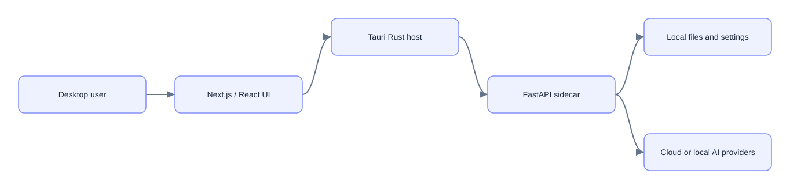
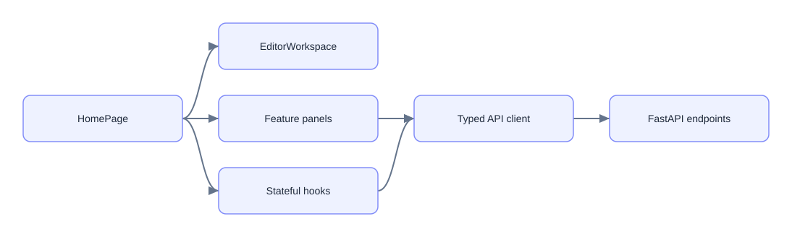
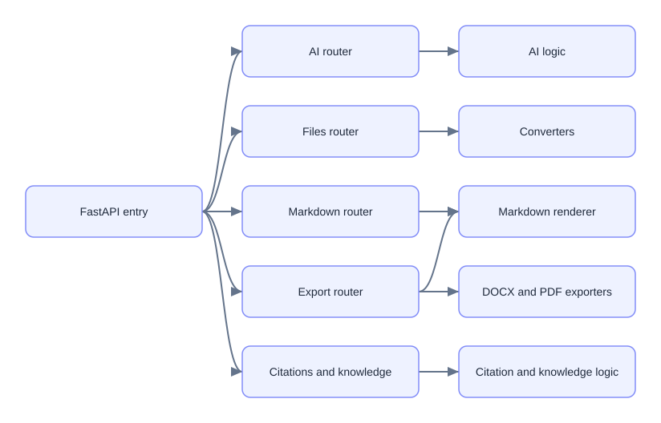
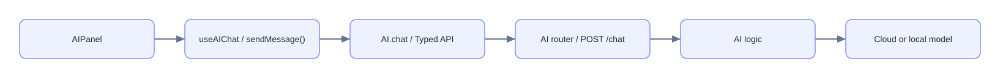
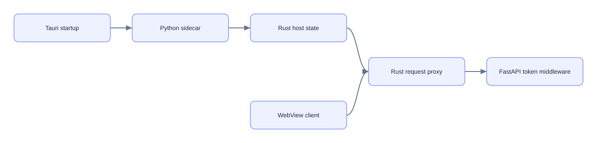

> [!IMPORTANT]
> 🎉 **Markdown Reader v2.2.0 is here!** 🎉
>
> We're celebrating the latest desktop release, now available for **macOS (Apple Silicon), Windows (x64), and Linux (x64)**. Thank you to everyone who has supported the project!
>
> 🚀 **[Download v2.2.0](https://github.com/petertzy/markdown-reader/releases/tag/v2.2.0)** · [View release notes](https://github.com/petertzy/markdown-reader/releases/tag/v2.2.0)
>
> **Installation note:** These builds are not notarized or signed with a verified developer certificate. Your operating system may display a security warning; verify the download before proceeding.

<div align="center">
  <h1>Markdown Reader</h1>
  <p><b>A local-first Markdown editor with live preview and AI-assisted writing tools.</b></p>

  [](#desktop-downloads)
  [](#desktop-downloads)
  [](#desktop-downloads)

  
</div>

Markdown Reader is a desktop Markdown editor and reader built with a Next.js frontend, a local FastAPI backend, and Tauri. It combines tabbed editing, live preview, a rich-text Focus Mode, optional AI assistance, project-wide tools, document conversion, citations, and publication export.

Files are managed locally by the app. Document or note content is sent to an external AI provider only when you use an AI feature that includes that content in its request. See the [AI panel and Notes Context guide](./docs/ProjectAIWorkflows.md) for details.

## Features

- **Editing and preview:** Edit Markdown in tabs with a rendered preview, document statistics, adjustable editor font size, and split-view controls.
- **Focus Mode:** Switch to a distraction-reduced rich Markdown editor with CommonMark/GFM support, math, paste handling, and an editor slash-command menu.
- **AI-assisted writing:** Chat about the active document, translate full documents or selections, use sentence-pair translation, summarize, format text, generate a table of contents, and clean up code blocks.
- **Reviewable AI changes:** Inspect chat suggestions before applying them; project-level changes are presented as diffs for review before they are staged in editor tabs.
- **Project workflows:** Translate Markdown files into a separate output tree, retry failed files, prepare multi-file AI changes, and assemble selected open documents into a publication draft.
- **Notes Context:** Index a local Markdown/text notes folder and retrieve relevant excerpts for AI chat using a local SQLite index.
- **AI providers:** Configure OpenAI, Anthropic, OpenRouter, or OpenAI-compatible endpoints, including local servers such as Ollama and LM Studio.
- **File conversion:** Open Markdown and text directly; convert supported HTML, PDF, DOCX, Office, spreadsheet, EPUB, XML, archive, image, audio, email, and notebook files when the relevant converter dependencies are available.
- **Citations and publication:** Browse a BibTeX library, insert citation-key markers into Markdown, combine selected open documents in a chosen order, and export supported formats.
- **Desktop integration:** Use native file and folder dialogs and packaged desktop releases through Tauri.

Feature availability can depend on the selected provider, installed optional dependencies, and whether the app is running as a packaged desktop app or in development. Review AI-generated changes, translations, and converted documents before relying on them.

## Desktop downloads

Official release builds and platform-specific installation notes are available from the [Markdown Reader downloads page](https://petertzy.github.io/markdown-reader/).

| Platform | Available release |
| --- | --- |
| macOS | Apple Silicon (aarch64-apple-darwin) |
| Windows | x64 (x86_64-pc-windows-msvc) |
| Linux | x64 (x86_64-unknown-linux-gnu) |

macOS Intel is not currently included in the release matrix. See [Code signing and distribution](./docs/CodeSigningAndDistribution.md) for release and signing details.

## Run from source

### Prerequisites

- Python 3.11 to 3.13
- [uv](https://docs.astral.sh/uv/)
- Node.js 20.9.0 or newer and npm
- Rust and the Tauri prerequisites for desktop-shell development

Python 3.14 is not currently supported because some optional MarkItDown dependencies do not yet provide compatible wheels.

### macOS and Linux

```bash
git clone https://github.com/petertzy/markdown-reader.git
cd markdown-reader
cp frontend/.env.local.example frontend/.env.local
./scripts/dev-tauri.sh
```

The helper installs/synchronizes the Python and frontend dependencies, starts the local FastAPI backend, and launches the Tauri development shell. It uses port 8000 when available and tries nearby ports if necessary. To request a port explicitly:

```bash
MARKDOWN_READER_BACKEND_PORT=8010 ./scripts/dev-tauri.sh
```

### Windows

From PowerShell, create the frontend environment file and launch the Windows helper:

```powershell
git clone https://github.com/petertzy/markdown-reader.git
cd markdown-reader
Copy-Item frontend/.env.local.example frontend/.env.local
.\scripts\dev-tauri.ps1
```

The PowerShell and batch wrappers call Git Bash at `C:\Program Files\Git\bin\bash.exe`. Install Git for Windows at that location, or run `scripts/dev-tauri.sh` from Git Bash.

When the backend uses port 8000, its API documentation is available at http://127.0.0.1:8000/docs. If another port is selected, use the port printed by the helper.

PDF export may require native system libraries for WeasyPrint. See the [technical documentation](./docs/TECHNICAL.md#pdf-export-dependencies), [macOS setup](./docs/PrepareForMacUser.md), and [Windows setup](./docs/PrepareForWindowsUser.md).

## Slash commands

Type `/` at the start of a line or after whitespace in the main editor to open the command menu.

| Command | Action |
| --- | --- |
| `/summarize` | Summarize the document with AI |
| `/translate` | Open the AI panel's Translate tab |
| `/format` | Format text with AI |
| `/toc` | Generate a table of contents with AI |
| `/fix-code` | Clean up Markdown code fences with AI |
| `/insert-table` | Insert a table without an AI request |
| `/insert-toc` | Generate a table of contents locally from document headings |

Use the arrow keys to move through the menu, Enter to run a command, and Escape to dismiss it. Focus Mode has its own editor slash-command menu.

## 🏗️ Architecture

Markdown Reader consists of a Next.js / React interface, a Tauri desktop host, and a local FastAPI service. The diagrams below summarize the five high-level views from the [interactive Architecture Explorer](./docs/architecture/index.html). They are simplified architectural maps rather than exhaustive function-call traces.

### 01 · System Overview

The desktop interface communicates with native Tauri capabilities and the Python backend. Document storage stays local; model requests can reach a configured cloud or local provider.



### 02 · Frontend Modules

The page composes the editor, feature panels, and stateful hooks. Panels and hooks use the typed API client for backend requests.



### 03 · Backend Modules

FastAPI registers routers for the main feature areas. Each router delegates work to the relevant domain implementation.



### 04 · AI Chat Request Flow

The chat panel passes a message through the React hook and typed client to the FastAPI AI endpoint, which delegates to the configured model provider.



In the packaged desktop app, API requests traverse the Tauri request proxy; the arrow from the client to the router abstracts that transport step.

### 05 · Desktop Runtime

In packaged builds, Tauri launches and supervises the Python sidecar. The Rust host retains the backend connection details and forwards authenticated requests from the WebView.



### Generate and Open the Interactive Architecture Explorer

These README diagrams provide an at-a-glance overview. To regenerate the source-scanned interactive explorer from your current checkout, run the following commands **from the repository root**:

```bash
python3 tools/generate_architecture.py
open docs/architecture/index.html
```

The generator writes `docs/architecture/index.html`; the `open` command opens that file on macOS. On Linux, use `xdg-open docs/architecture/index.html`; on Windows, use `start docs/architecture/index.html`.

The explorer supports zooming, panning, node inspection, and exporting a selected view as SVG. Its source-derived function views may vary as the code changes. The five static SVG diagrams embedded above are maintained in `docs/architecture/` and do **not** update automatically when the generator is run.

---

## Documentation

- [User guide](./docs/UserGuide.md): editor modes, files and projects, AI settings, import, citations, and export.
- [AI panel and Notes Context](./docs/ProjectAIWorkflows.md): Chat, document Work, provider settings, and local notes retrieval.
- [Project workflows](./docs/ProjectWorkflows.md): project translation, reviewable project-wide AI changes, and publication drafts.
- [Keyboard shortcuts](./docs/KeyboardShortcuts.md): default application and editor shortcuts.
- [Documentation index](./docs/index.md): user guides, technical references, platform notes, and planning documents.
- [Technical documentation](./docs/TECHNICAL.md): architecture, local backend security, PDF export dependencies, and local packaging.
- [Code signing and distribution](./docs/CodeSigningAndDistribution.md): current release signing notes and distribution research.
- [macOS setup](./docs/PrepareForMacUser.md) and [Windows setup](./docs/PrepareForWindowsUser.md): platform-specific PDF export dependencies.
- [Contributing guide](./CONTRIBUTING.md): development setup, checks, and contribution workflow.

## Contributing

Contributions are welcome, including bug fixes, focused improvements, tests, and documentation updates. Start with the [contributing guide](./CONTRIBUTING.md), keep changes focused, and run the checks relevant to the files you changed.

## License

Released under the [MIT License](./LICENSE.md).
