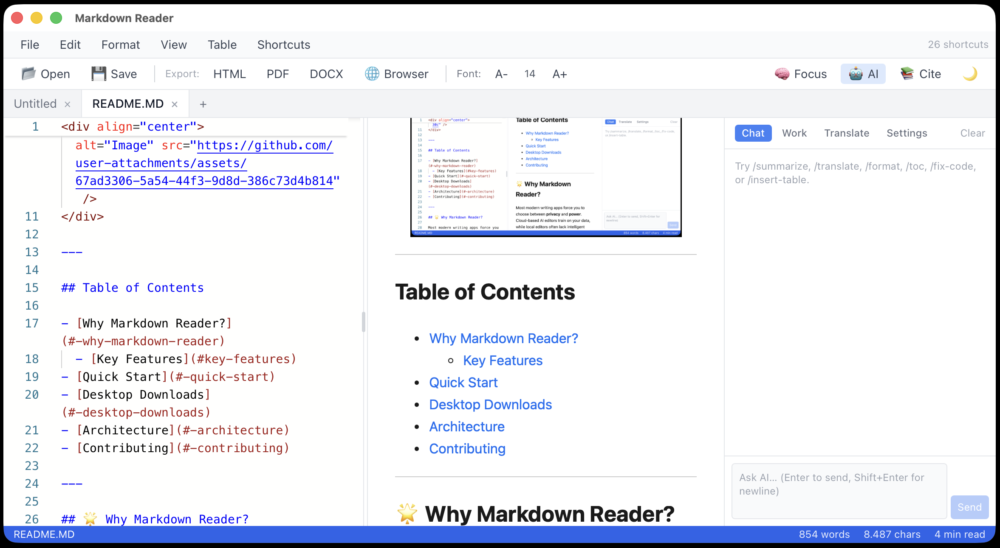

<div align="center">
  <h1>Markdown Reader</h1>
  <p><b>The open-source, local-first Markdown editor with native AI capabilities.</b></p>
  
  [](#desktop-downloads)
  [](#desktop-downloads)
  [](#desktop-downloads)
  
  <br />
  
</div>

---

## Table of Contents

- [Why Markdown Reader?](#-why-markdown-reader)
  - [Key Features](#key-features)
- [Quick Start](#-quick-start)
- [Desktop Downloads](#-desktop-downloads)
- [Slash Commands](#-slash-commands)
- [Local Model Support](#-local-model-support)
- [Universal File Import](#-universal-file-import)
- [Academic Citations](#-academic-citations)
- [Technical Documentation](#-technical-documentation)
- [Contributing](#-contributing)

---

## 🌟 Why Markdown Reader?

Most modern writing apps force you to choose between **privacy** and **power**. Cloud-based AI editors train on your data, while local editors often lack intelligent features.

**Markdown Reader bridges the gap.** It is a native desktop application built on Tauri, ensuring your files stay locally on your machine. But it also seamlessly integrates with **OpenAI, Anthropic, OpenRouter, and Local LLMs**, bringing powerful AI-assisted writing directly to your offline workflow.

### Key Features

- 🔒 **Local-First Architecture**: Your files never leave your machine unless you explicitly call an external AI API.
- 🤖 **Bring-Your-Own-AI**: Configure OpenAI, Anthropic, OpenRouter, OpenAI-compatible providers, or local models.
- ✍️ **Intelligent Editing**: AI-assisted translation, sentence-by-sentence comparison, summarization, formatting, and code-block cleanup.
- ⚡ **Slash Commands**: Type `/` in the editor to trigger AI actions or insert a table inline, without opening the AI panel.
- 🛡️ **Audit & Rollback**: Review all AI suggestions before applying them. Reject or rollback changes with a single click.
- 🖥️ **Native Desktop Feel**: Built with Next.js and packaged with Tauri for blazing-fast performance.
- 📊 **Document Statistics**: View word count, character count, heading count, and estimated reading time for the current document (based on 238 words per minute).

---

## 🚀 Quick Start

Get the app running locally for development in under a minute:

```bash
# Prerequisites: Python 3.11-3.13, Node.js 20.9.0+, and uv
git clone https://github.com/petertzy/markdown-reader.git
cd markdown-reader

# Install dependencies
uv sync
cd frontend && npm install && cd ..

# Configure frontend environment variables
cp frontend/.env.local.example frontend/.env.local

# Launch the Tauri desktop app
./scripts/dev-tauri.sh
```

The development helper starts the FastAPI backend on `127.0.0.1:8000` when that
port is available. If port `8000` is already occupied by another process, it
automatically chooses a free local port and passes it to the Tauri shell. To
request a specific backend port, run:

```bash
MARKDOWN_READER_BACKEND_PORT=8010 ./scripts/dev-tauri.sh
```

> PDF export may need extra system libraries on macOS and Windows. See
> [Technical Documentation](./docs/TECHNICAL.md#pdf-export-dependencies) for
> those steps.

---

## 📦 Desktop Downloads

We provide official desktop release builds through GitHub Actions.

| OS          | Architecture  | Download                                                          |
| ----------- | ------------- | ----------------------------------------------------------------- |
| **macOS**   | Apple Silicon | [Download .dmg](https://petertzy.github.io/markdown-reader/)      |
| **Windows** | x64           | [Download .exe](https://petertzy.github.io/markdown-reader/)      |
| **Linux**   | x64           | [Download .AppImage](https://petertzy.github.io/markdown-reader/) |

_(Note: macOS Intel builds are currently unsupported due to advanced PDF dependency constraints)._

---

## ⚡ Slash Commands

Type `/` at the start of a line (or after whitespace) in the editor to open an inline command menu:

| Command | Behavior |
| --- | --- |
| `/summarize` | Summarizes the document via AI |
| `/translate` | Opens the AI panel's Translate tab |
| `/format` | Applies Markdown formatting via AI |
| `/toc` | Generates a table of contents via AI |
| `/fix-code` | Fixes code block fences via AI |
| `/insert-table` | Inserts a Markdown table (no AI call) |
| `/insert-toc` | Inserts a table of contents generated locally from the document headings (no AI call) |

Use the arrow keys to navigate, Enter to run a command, or Escape to dismiss the menu.

---

## 🧠 Local Model Support

Markdown Reader can call locally hosted OpenAI-compatible model servers. In the AI settings panel, choose **Local Model**, select **LM Studio**, **Ollama**, or **Custom**, fetch available models, and save the model you want to use. Local endpoints do not require an API key unless your local server is configured to require one.

---

## 📥 Universal File Import

Markdown Reader can import Markdown/text files directly and convert HTML, PDF, DOCX, Office files, CSV, EPUB, XML, archives, images, audio, Outlook messages, and Jupyter notebooks to Markdown through the bundled MarkItDown converter. Python 3.14 is not currently supported because some MarkItDown optional dependencies do not publish Python 3.14 wheels yet.

---

## 📚 Academic Citations

Use the **Cite** panel to load a BibTeX `.bib` library, search by citation key, author, title, year, publication venue, or entry type, and insert citation references such as `[@doe2024]` at the current cursor position. In the desktop app, click **Select** to choose a `.bib` file with the native file picker. In browser development mode, the same button uploads the selected `.bib` file to the local backend and stores it as the active citation library.

Markdown Reader preserves citation syntax during editing and export, including HTML, DOCX, and PDF output.

---

## 📖 Technical Documentation

For advanced and implementation details, see [Technical Documentation](./docs/TECHNICAL.md). It covers:

- Architecture, including the FastAPI backend, Next.js/Tauri frontend, and the bundled Python sidecar
- Local backend security and the Desktop Content Security Policy
- PDF export dependencies for macOS and Windows
- Building release artifacts locally

In short: Markdown Reader is split into a FastAPI backend and a Next.js frontend packaged with Tauri. When packaged for desktop use, the Python backend is bundled as a silent Tauri sidecar process, dynamically assigning ports at runtime to avoid conflicts.

---

## 🤝 Contributing

Contributions are highly welcome! Whether you're fixing a bug, suggesting a feature, or helping us write documentation, we'd love to have you.

To get started:

1. `git checkout -b your-feature-branch`
2. Run linting: `uv run ruff check .`
3. Run tests: `uv run python -m unittest discover -s tests`
4. Open a Pull Request!

After cloning, run `uv sync --extra dev` and `uv run pre-commit install` to set up linting hooks.

See our full [Contribution Guidelines](CONTRIBUTING.md) for more details.

---

<div align="center">
  Released under the MIT License. See <a href="LICENSE.md">LICENSE.md</a> for details.
</div>
